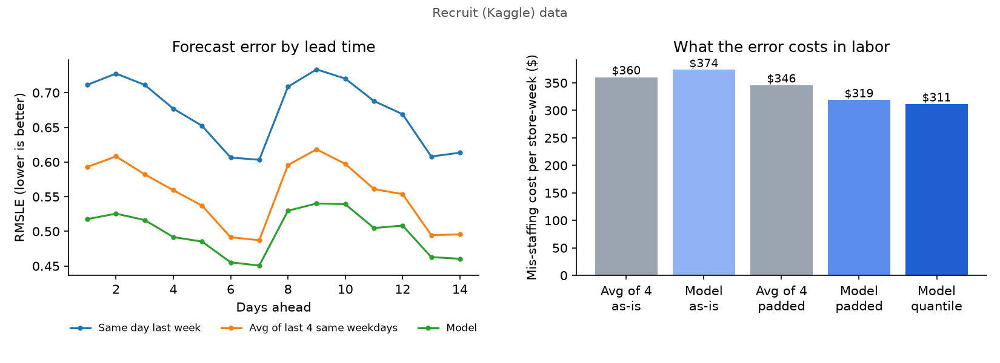
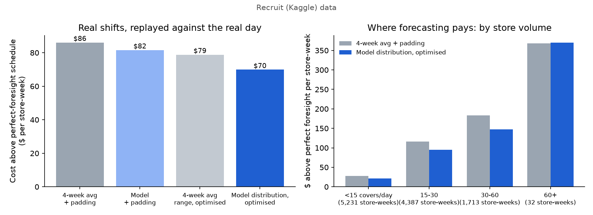

# covercast

Forecast restaurant covers 1 to 14 days ahead, turn the forecast into real
shift schedules, and score both by replaying the night that actually happened.

Restaurant software turns a cover forecast into a labor plan. Forecast error
is the usual scorecard, but it isn't what the restaurant pays for. A
short-staffed Friday means overtime, call-ins and slow tables; an overstaffed
one means idle wages; and staff come in whole people working 3-to-8-hour
blocks, with someone on the floor whenever the doors are open. covercast
measures forecasts by what they cost once they become a schedule.

**[Shift board demo](https://anoopibrampur.github.io/covercast/)**: pick a
restaurant, see its next two weeks with forecast ranges, the shifts each
method would post, why the forecast moved, and what each roster cost once the
real night is replayed. The public demo runs on synthetic data, because the
Kaggle data can't be republished.

## Findings

820 restaurants, 8 weekly cutoffs, 79,546 store-day forecasts for
2017-02-19 to 2017-04-22. Every forecast was made 1 to 14 days ahead using
only what was known at its cutoff, including only the bookings made by then.

1. **The most accurate forecast isn't the cheapest one to staff to.** The
   model beats both manager baselines on accuracy at every lead time, but
   it comes in 13% under total covers. Staffed as-is, it costs more than the
   plain four-week average.
2. **Forecasting the right quantity fixes that.** A calibrated forecast
   distribution, staffed at the cost-optimal quantile, cuts mis-staffing cost
   by 10% under a smooth labor model, in all 8 test weeks.
3. **Real shifts absorb about half of that.** Built into integer shifts with
   a minimum crew and replayed hour by hour, the saving is $16 per
   store-week, 19% of the cost that perfect foresight would avoid. A better
   forecast alone recovers $4.50 of that, and planning against the
   forecast's range alone recovers $7. Together they recover $16.
4. **The gain grows with volume,** except at the very top: for the 5
   busiest restaurants the model only ties the four-week average.



### Forecasts, scored per day

| forecast | RMSLE | bias | mis-staffing $ per store-week |
|---|---:|---:|---:|
| Same day last week | 0.672 | 0.0% | $431 |
| Average of last 4 same weekdays | 0.554 | -1.9% | $360 |
| **Model, accuracy-tuned** | **0.498** | **-13.0%** | **$374** |
| Average of 4, best padding | | | $346 |
| Model, best padding | | | $319 |
| Model, cost-optimal quantile (direct) | | | $311 |
| **Model, calibrated distribution** | | | **$311** |

- **Accuracy.** RMSLE is 0.056 lower than the best baseline (95%
  store-bootstrap interval 0.051 to 0.061), better at every lead time and in
  all 8 weeks.
- **Why accurate costs more.** Minimising squared log error aims at the
  typical day. Covers are right-skewed, so the typical day sits below the
  average day, and the shortfall lands on the expensive side.
- **Cost.** The cost-optimal forecast saves $34 per store-week against the
  best padded baseline (95% interval $31 to $38), 8 of 8 weeks. The savings
  are largest around holidays (20%) and at restaurants that take bookings
  (13%), and still 7.5% at the ones that don't.

The smooth cost model prices each forecast error linearly: wage $18/h,
4 covers per variable labor hour, and a short hour costing 2x an idle one.
The 2x is an assumption, so the backtest was rerun at 1x and 3x:

| short hour costs | staff to | 4-week avg as-is | model as-is | padded 4-week avg | model, cost-optimal | saving | weeks won |
|---|---:|---:|---:|---:|---:|---:|---:|
| 1x | median | $236 | $220 | $236 | $215 | $21 (9%) | 8/8 |
| 2x | 67th pct | $360 | $374 | $346 | $311 | $34 (10%) | 8/8 |
| 3x | 75th pct | $485 | $528 | $426 | $378 | $48 (11%) | 8/8 |

When short and idle hours cost the same, the accuracy-tuned model is already
the cheapest as-is forecast. The more being short costs, the further staffing
to it falls behind.

### Real shifts, replayed against the real night



For every store-day, each policy posts a schedule: whole people, shifts of 3 to
8 hours, at least one person on the floor in open hours. Then the day's actual
covers are spread over the hours and each schedule pays wages for every hour
it booked, plus 2x for every staff-hour of need it left uncovered. The floor is
a perfect-foresight schedule built on the realized hours.

| policy | wages + shortfall per store-week | above perfect foresight |
|---|---:|---:|
| 4-week average + best padding | $1,742 | $86 |
| Model mean + best padding | $1,738 | $82 |
| 4-week average's error range, optimised | $1,735 | $79 |
| **Model distribution, optimised** | **$1,726** | **$70** |
| Perfect foresight | $1,656 | – |

The optimised model schedule saves $16.20 per store-week against the padded
four-week average (95% interval $14.10 to $18.50), and $11.70 against the
padded model mean, in all 8 weeks for both comparisons.

| typical covers per day | store-days | padded 4-week avg | model distribution | avoidable cost cut |
|---|---:|---:|---:|---:|
| under 15 | 36,616 | $27 | $21 | 22% |
| 15 to 30 | 30,708 | $116 | $95 | 18% |
| 30 to 60 | 11,993 | $184 | $148 | 19% |
| over 60 | 222 | $368 | $370 | -1% |

Small places barely need a forecast: one person covers the whole evening
whatever happens. The money is in the mid-size and busy rooms. The top band is
5 restaurants and too small to read much into. Its first result was much worse
(next section), and even after the fix the plain four-week average is the more
accurate forecast for them (RMSLE 0.31 vs 0.35 on the last four cutoffs).
Restaurant groups with many high-volume locations would give the model far more
to learn from in that range.

## What went wrong along the way

- **Calibrating on a stale model.** The first forecast distribution took its
  error spread from a model trained 4 to 8 weeks before the days it was
  checked on, while real forecasts are 0 to 2 weeks out. Recruit's stores
  were growing, so the stale model's errors leaned high and the medians came
  out 5 points too high (55% of days fell under the median instead of 50%).
  Calibrating on each cutoff's own walk-forward forecast fixed most of it.
  Coverage is now 10.8 / 26.8 / 52.8 / 77.0 / 90.9% at the 10 / 25 / 50 / 75 / 90%
  levels, and pinball loss is 2.58 covers against 2.93 for the baseline's
  own error range.
- **One model for every size of restaurant.** Trees can't extrapolate. With
  mostly small restaurants in training, the model pulled the busiest ones
  toward the middle and under-forecast them by 31%. In the shift replay its
  schedules for them cost $100 a week more than the four-week average's.
  Predicting each day relative to the store's own level cut that bias to 13%
  and left every other size band unchanged.

## Method

- **Walk-forward.** Weekly cutoffs. At each evaluation cutoff the model is
  retrained only on earlier cutoffs whose whole 14-day horizon had already
  happened, so no training target postdates the forecast being judged.
- **Bookings as of the cutoff.** A booking made the day after the cutoff is
  invisible to that forecast even though it's in the file.
  [`test_features_ignore_everything_after_cutoff`](tests/test_features.py)
  replaces every visit and booking after the cutoff with noise and checks that
  no feature changes. Planting a one-day booking leak makes it fail.
- **Closed is not zero.** A missing day means the store was shut. It is never
  a target, and never averaged in as a zero.
- **Point model.** One gradient-boosted model (scikit-learn
  `HistGradientBoosting`) across all stores and lead times, predicting log
  covers relative to the store's own same-weekday level. Features are recent
  levels, same-weekday history, holidays, store type and area, bookings known
  so far, and how those compare with what the store usually has booked at the
  same lead time.
- **Distribution.** `log covers = center + scale * z`. A second model predicts
  `scale`, how far off the point model tends to be for this kind of
  store-day. `z` comes from the standardized errors of recent walk-forward
  forecasts that neither model trained on (split conformal), so the shape of
  the errors is measured, not assumed.
- **When guests arrive.** An hourly arrival profile per restaurant from the
  times its bookings were for, shrunk toward its genre's profile when it has
  few bookings, using only bookings up to the cutoff.
- **Shifts.** An integer program picks how many people start at each hour for
  each shift length. It minimises wages plus the expected cost of being short
  over 200 demand scenarios, with a minimum crew in open hours. Because
  coverage is a whole number of people, the expected shortfall per hour can be
  precomputed at each staffing level. That makes the program's size independent
  of the scenario count (about 14 ms per solve with HiGHS), and a test checks
  it against the textbook one-variable-per-scenario formulation.
- **Fair baselines.** Each baseline gets the constant padding ("last week +
  10%") that would have minimised its cost on past cutoffs, and is also
  optimised against its own historical error range.

| assumption | default | where |
|---|---|---|
| wage | $18/h | `--wage` |
| staff time per cover | 15 min (4 covers per labor hour) | `--covers-per-hour` |
| cost of a short staff-hour vs an idle one | 2x | `--under-multiplier` |
| minimum crew in open hours | 1 | `covercast schedule --min-crew` |
| shift lengths | 3 to 8 hours | `ScheduleParams` |

## Run it

```bash
python3 -m venv .venv && .venv/bin/pip install -e ".[dev]"
.venv/bin/python -m pytest -q
```

On synthetic data in the same schema (no download needed):

```bash
.venv/bin/covercast synth
.venv/bin/covercast backtest --data-dir artifacts/synthetic
.venv/bin/covercast schedule artifacts/results/synthetic --data-dir artifacts/synthetic
.venv/bin/covercast site artifacts/results/synthetic --data-dir artifacts/synthetic
```

Real data: accept the competition rules on Kaggle, download the data, unzip
the CSVs into `artifacts/raw/`, then:

```bash
.venv/bin/covercast backtest
.venv/bin/covercast schedule artifacts/results/recruit
```

The backtest takes about 10 minutes and the shift replay about 13 on a laptop.
Summaries and figures go to `artifacts/results/<dataset>/`.

## Limits

- **The hourly split is inferred.** Recruit has daily covers, so the hourly
  pattern comes from booking times. Bookings lean toward dinner, so walk-in
  lunch trade is probably undercounted. Timestamped POS sales would replace
  this directly.
- **Staffing parameters are assumptions,** and each one is a flag.
- **These are small Japanese restaurants.** US multi-unit groups are bigger
  and may behave differently. The method carries over; the numbers might not.
- **The schedule is optimised one day at a time.** Weekly limits like
  maximum hours per person or labor law constraints are not modelled.

## License

MIT
